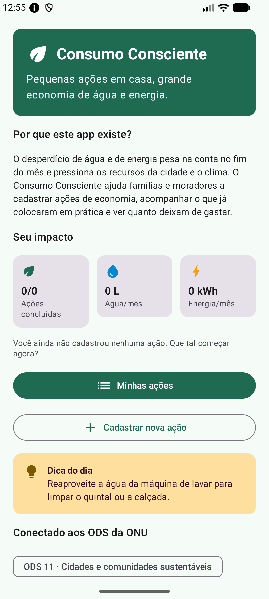
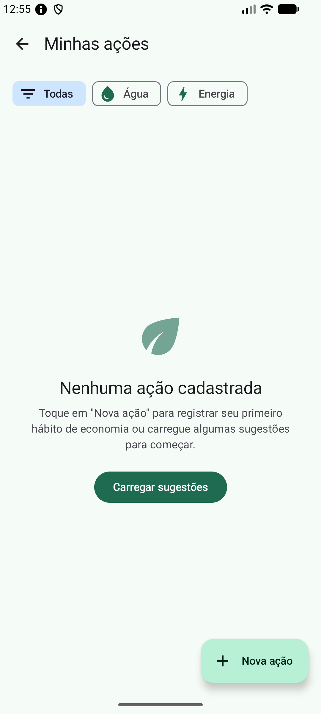
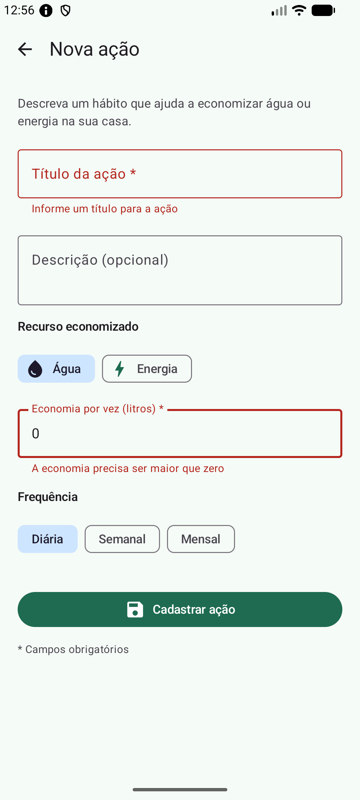
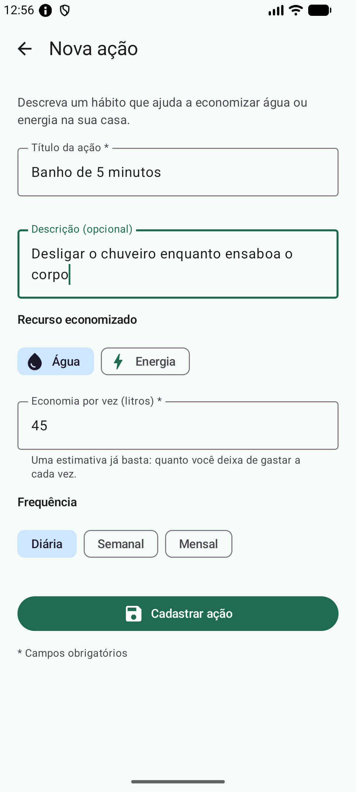
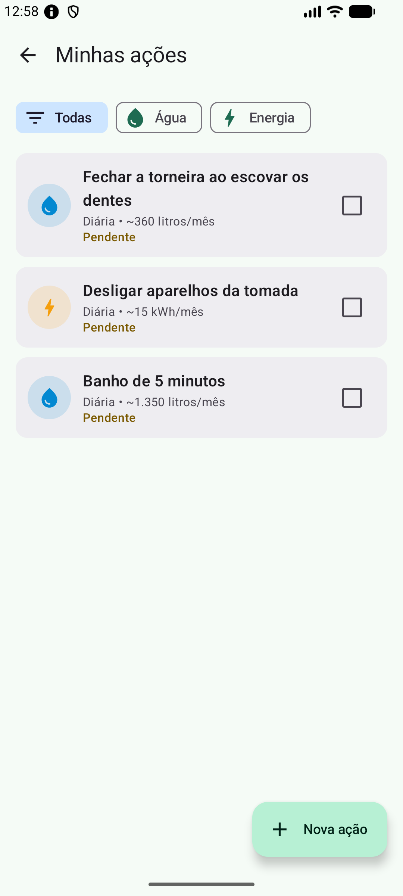
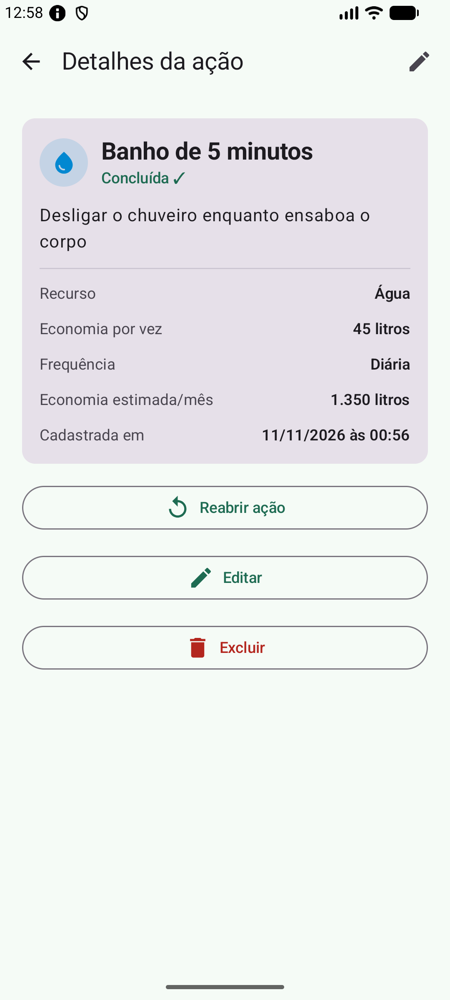
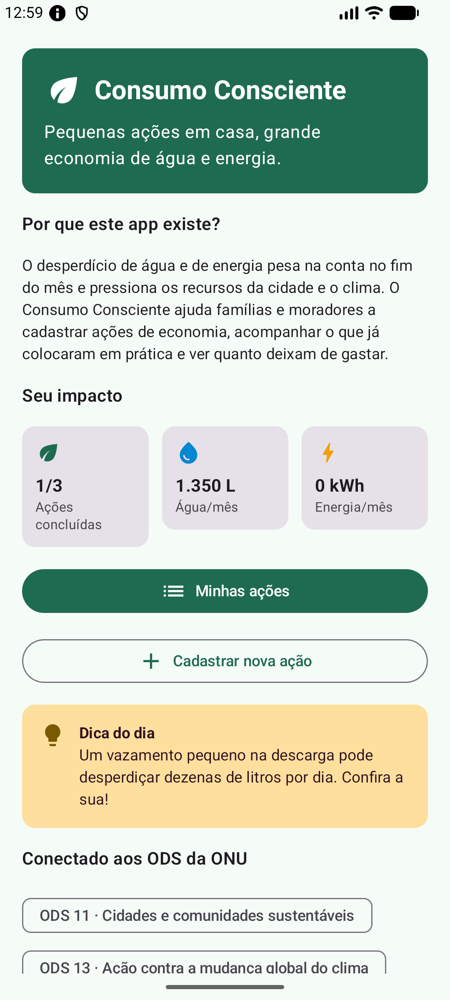
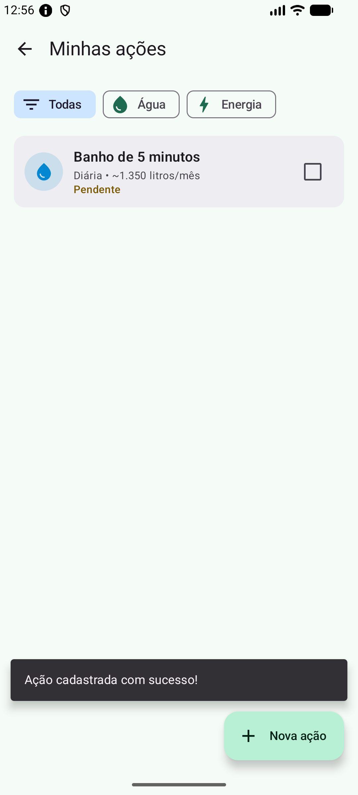
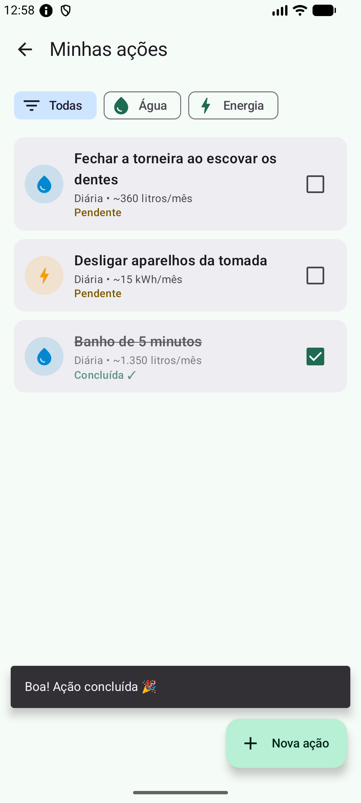
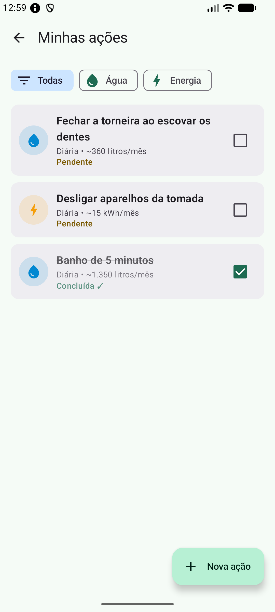

# 💧⚡ Consumo Consciente

> Pequenas ações em casa, grande economia de água e energia.

Aplicativo Android desenvolvido para a **Global Solution 2026 – 2º semestre (FIAP)**, disciplina **Android Kotlin Developer**, dentro do desafio **CitizenTech: tecnologia que melhora a vida das pessoas**.

---

## 👥 Equipe

| Nome completo | RM |
|---|---|
| Felipe Teixeira | RM 556100 |
| Maria Eduarda de Araujo Fernandes | RM 554543 |
| Gustavo Oda | RM 556754 |

## 🎬 Vídeo pitch

**Link do vídeo:** _[inserir o link aqui](https://)_

---

## 🧩 O problema

O desperdício de água e de energia elétrica dentro de casa costuma passar despercebido: banhos longos, torneira aberta enquanto se escova os dentes, aparelhos em stand-by a noite inteira, máquina de lavar rodando meio vazia. Cada hábito parece pequeno, mas somados eles:

- **pesam no orçamento** das famílias, com contas de água e luz mais altas;
- **pressionam os recursos da cidade**, como os reservatórios de abastecimento e a rede elétrica;
- **contribuem para as emissões** ligadas à geração de energia.

Muita gente quer economizar, mas não tem um jeito simples de **organizar as mudanças de hábito** e **enxergar o resultado** delas.

## 🙋 Público beneficiado

Famílias e moradores de áreas urbanas, especialmente quem quer reduzir a conta no fim do mês e não sabe por onde começar. O app tem linguagem simples e sem termos técnicos, para que qualquer pessoa da casa consiga usar.

## 💡 Proposta

O **Consumo Consciente** é um protótipo de app em que o cidadão:

1. **cadastra ações de economia** (ex.: "Banho de 5 minutos"), informando se economizam água ou energia, quanto economizam a cada vez e com que frequência;
2. **acompanha** as ações pendentes e as já concluídas (colocadas em prática);
3. **visualiza o impacto** estimado: litros de água e kWh de energia economizados por mês.

> Protótipo acadêmico: os valores de economia são **estimativas informadas pelo próprio usuário** (ou sugestões ilustrativas). O app não se integra a concessionárias nem a serviços públicos.

## 🌎 ODS relacionados

| ODS | Por que se conecta ao app |
|---|---|
| **ODS 11 – Cidades e comunidades sustentáveis** | Água tratada e energia elétrica são recursos compartilhados da cidade. Quando cada casa reduz o desperdício, diminui a pressão sobre o abastecimento e a infraestrutura urbana, contribuindo para cidades mais sustentáveis e resilientes, por exemplo em períodos de estiagem. |
| **ODS 13 – Ação contra a mudança global do clima** | Gerar e distribuir energia e tratar e bombear água consomem recursos e geram emissões. Ao incentivar hábitos que reduzem o consumo, o app estimula ações individuais e mensuráveis de mitigação, além de conscientizar com dicas educativas sobre o tema. |

---

## ✨ Funcionalidades

- **Tela inicial** com identidade visual, objetivo do app, problema, painel de impacto (ações concluídas, litros/mês e kWh/mês), dica do dia e ODS relacionados.
- **Cadastro de ações** com validação:
  - **título obrigatório** (mínimo de 3 caracteres);
  - **economia obrigatória**, numérica e maior que zero (aceita vírgula, ex.: `0,5`).
- **Listagem** em `LazyColumn`, com **filtro** por recurso (Todas / Água / Energia).
- **Ações adicionais sobre os registros:**
  - ✅ **marcar como concluída / reabrir** (checkbox na lista ou botão no detalhe);
  - ✏️ **editar**;
  - 🗑️ **excluir** (com diálogo de confirmação).
- **Detalhes** da ação com cálculo da economia mensal estimada (economia por vez × frequência).
- **Mensagens de feedback** (Snackbar) para cadastro, edição, conclusão e exclusão.
- **Estados sem dados**: mensagens amigáveis quando não há ações ou quando o filtro não retorna nada, com botão para carregar sugestões de exemplo.
- **Persistência local com Room**: tudo continua salvo depois de fechar e abrir o app.

## 🛠️ Tecnologias utilizadas

- **Kotlin**
- **Jetpack Compose** + **Material 3** (`Scaffold`, `TopAppBar`, `Card`, `LazyColumn`, `OutlinedTextField`, `FilterChip`, `Button`, `Snackbar`, `AlertDialog`…)
- **Navigation Compose** (rotas com argumentos)
- **ViewModel** + **StateFlow** / estado do Compose
- **Room** (com KSP) para o banco de dados local
- **Coroutines** e **Flow**

## 🗂️ Organização do código

```
app/src/main/java/br/com/fiap/consumoconsciente/
├── MainActivity.kt                    # ponto de entrada (setContent + tema)
├── ConsumoConscienteApplication.kt    # cria o repositório uma única vez
├── data/                              # ── CAMADA DE DADOS
│   ├── model/
│   │   ├── AcaoEconomia.kt            # @Entity (tabela do Room)
│   │   └── Enums.kt                   # TipoRecurso (Água/Energia) e Frequencia
│   ├── local/
│   │   ├── AcaoDao.kt                 # consultas, inserção, edição, exclusão
│   │   └── AppDatabase.kt             # banco Room (singleton)
│   └── repository/
│       └── AcaoRepository.kt          # acesso aos dados para os ViewModels
└── ui/                                # ── INTERFACE + LÓGICA DE APRESENTAÇÃO
    ├── navigation/AppNavigation.kt    # rotas e NavHost
    ├── viewmodel/
    │   ├── AcoesViewModel.kt          # estado da Home e da Lista (resumo, filtro)
    │   └── AppViewModelProvider.kt    # fábrica de ViewModels
    ├── screens/
    │   ├── home/HomeScreen.kt
    │   ├── lista/ListaScreen.kt
    │   ├── detalhe/DetalheScreen.kt + DetalheViewModel.kt
    │   └── formulario/FormularioScreen.kt + FormularioViewModel.kt
    ├── components/                    # AcaoCard, EstadoVazio, formatação
    └── theme/                         # cores e tema Material 3
```

**Fluxo dos dados:** `Tela (Compose)` → chama função do `ViewModel` → `Repository` → `DAO (Room)`.
O DAO devolve um `Flow`; quando a tabela muda, o Room emite os novos dados, o `ViewModel` os expõe como `StateFlow` e a tela se redesenha sozinha.

### Entidade `AcaoEconomia`

| Atributo | Tipo | Descrição |
|---|---|---|
| `id` | Long | Identificador (gerado automaticamente) |
| `titulo` | String | Nome da ação (**obrigatório**) |
| `descricao` | String | Como colocar em prática |
| `recurso` | TipoRecurso | Água ou Energia |
| `economiaPorVez` | Double | Litros ou kWh economizados a cada vez (**obrigatório, > 0**) |
| `frequencia` | Frequencia | Diária, semanal ou mensal |
| `concluida` | Boolean | Se a ação já foi colocada em prática |
| `criadaEm` | Long | Data de cadastro |

---

## ▶️ Como executar

1. Instale o **Android Studio** (versão recente) com o SDK Android 35.
2. Descompacte o `.zip` e, no Android Studio, vá em **File → Open** e selecione a pasta `ConsumoConsciente`.
3. Aguarde o **Gradle Sync** terminar (na primeira vez ele baixa as dependências; é preciso internet).
   - Se o Android Studio sugerir atualizar o Android Gradle Plugin, pode aceitar.
4. Crie ou selecione um **emulador** (Device Manager), ou conecte um celular com Android 8.0 (API 26) ou superior e a depuração USB ativada.
5. Clique em **Run ▶ ('app')**.

---

## 🔁 Fluxo principal

1. Na **tela inicial**, o usuário conhece o app e toca em **Cadastrar nova ação** (ou em **Minhas ações**).
2. No **formulário**, preenche título, recurso, economia por vez e frequência. Se deixar o título vazio ou digitar uma economia inválida, o app mostra o erro no campo e **não salva**.
3. Ao salvar, aparece a mensagem **"Ação cadastrada com sucesso!"** e a ação já aparece na **lista**.
4. Na lista, o usuário filtra por Água ou Energia e **marca a ação como concluída** pelo checkbox.
5. Tocando na ação, abre o **detalhe**, onde é possível reabrir, **editar** ou **excluir**.
6. O **painel de impacto** da tela inicial soma a economia mensal das ações concluídas.
7. Ao **fechar e reabrir o app**, todas as ações continuam lá (Room).

---

## 📸 Capturas de tela

> Prints reais do app rodando no emulador Android (API 37, 1080×2400). Arquivos em `docs/screenshots/`.

| Tela inicial (sem dados) | Lista vazia (estado sem dados) | Validação do formulário |
|---|---|---|
|  |  |  |

| Formulário preenchido | Lista com registros | Detalhe da ação |
|---|---|---|
|  |  |  |

| Tela inicial com o painel de impacto atualizado |
|---|
|  |

- **Tela inicial (sem dados):** nome, objetivo, problema, painel de impacto zerado, mensagem de estado vazio, botões de acesso, dica do dia e ODS.
- **Lista vazia:** mensagem amigável quando ainda não há ações, com o botão "Carregar sugestões" e o botão "Nova ação".
- **Validação:** ao tentar salvar com o título vazio e a economia igual a `0`, o app mostra os erros nos campos ("Informe um título para a ação" e "A economia precisa ser maior que zero") e **não salva**.
- **Formulário preenchido:** "Banho de 5 minutos", Água, 45 litros por vez, frequência diária.
- **Lista com registros:** três ações cadastradas pelo formulário (água e energia), cada uma com a economia mensal estimada e o status.
- **Detalhe:** dados completos da ação, economia estimada por mês (45 L × 30 = 1.350 L), data de cadastro e os botões **Reabrir**, **Editar** e **Excluir**.
- **Painel de impacto:** depois de concluir uma ação, a tela inicial mostra "1/3 ações concluídas" e "1.350 L água/mês".

### Evidências solicitadas

| 1. Criação de um registro | 2. Ação adicional (concluir) | 3. Registro após reabrir o app |
|---|---|---|
|  |  |  |

1. **Criação:** logo após tocar em "Cadastrar ação", a ação "Banho de 5 minutos" aparece na lista com o Snackbar **"Ação cadastrada com sucesso!"**.
2. **Ação adicional:** a mesma ação foi marcada como **concluída** pelo checkbox: o título fica riscado, o status muda para "Concluída ✓" e aparece o Snackbar "Boa! Ação concluída 🎉". O painel da tela inicial também foi atualizado (print acima).
3. **Persistência:** o app foi **fechado por completo** (removido da tela de recentes, com o processo encerrado) e aberto de novo pelo ícone; as três ações continuam salvas no Room e "Banho de 5 minutos" continua concluída.

---

## 📝 Observações

- Não há autenticação, backend nem sincronização em nuvem, conforme o escopo da atividade.
- As sugestões de exemplo e as dicas da tela inicial são conteúdos locais e ilustrativos.
- Os prints estão em `docs/screenshots/`. Se o preview do README não carregar as imagens locais no Android Studio, abra o arquivo no VS Code ou veja o repositório no GitHub: [https://github.com/Feteixeira/GS_Kotlin.git].
